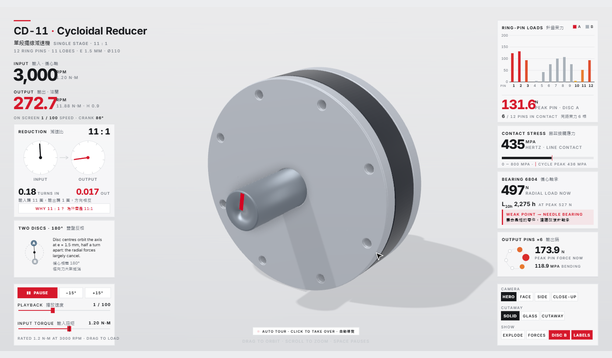

# Mechanical design demos · 機械設計作品集

**▶ Open the website (no download, no install): https://0smallcat0.github.io/mechanical-design-demos/**

**▶ 直接打開網站（不用下載、不用安裝）：https://0smallcat0.github.io/mechanical-design-demos/**

Everything runs in your web browser (Chrome, Edge, Safari, Firefox). The interactive 3D model is made for a computer screen; on a phone, open the project pages and the video.
The file list above is only the source of the website; you do not need to open any of it.

全部在瀏覽器裡開就能用。互動 3D 模型是給電腦螢幕用的，手機請看專案頁和影片。上面那一排檔案只是網站的原始檔，一般人不用點。

**Want one for your product? Order on Fiverr:** [mechanical animation](https://www.fiverr.com/lychnis_/create-a-mechanical-animation-showing-how-your-machine-works) · [product renders](https://www.fiverr.com/lychnis_/do-photorealistic-3d-product-rendering-and-exploded-views-from-your-cad) · [CAD model and drawing](https://www.fiverr.com/lychnis_/convert-your-sketch-or-pdf-into-a-3d-cad-model-and-2d-technical-drawing) · [3D viewer for your website](https://www.fiverr.com/lychnis_/build-an-interactive-3d-product-viewer-for-your-website-with-threejs)

---

## CD-11 cycloidal reducer · CD-11 擺線減速機

**▶ [Open the 3D model · 打開 3D 模型](https://0smallcat0.github.io/mechanical-design-demos/cd11-cycloid-reducer/live.html)**  ·  [Project page with video, drawings and CAD files · 專案頁（影片、工程圖、CAD 檔）](https://0smallcat0.github.io/mechanical-design-demos/cd11-cycloid-reducer/)

A gearbox that turns a fast motor (3,000 rpm) into a slow, strong output (272.7 rpm, 11:1). The model moves, and the numbers on both sides (forces, stress, bearing life) are calculated live from the same motion.

把馬達的高轉速（3,000 rpm）降成慢而有力的輸出（272.7 rpm，11:1）的減速機。模型會動，兩側的數字（受力、應力、軸承壽命）跟著動作即時算出來。

How to use · 怎麼用：

| Do this · 動作 | What happens · 結果 |
| --- | --- |
| Just watch · 先看就好 | It starts with an automatic tour · 一開始會自動導覽 |
| Drag with the mouse / scroll · 拖曳、滾輪 | Turn and zoom · 轉視角、縮放 |
| **EXPLODE** (bottom right · 右下) | Pulls the parts apart so you see every piece · 把零件拆開來看 |
| **CUTAWAY** / **GLASS** | Cuts the housing open / makes it see-through · 剖開外殼／外殼變透明 |
| **FORCES** | Shows the force arrows · 顯示受力箭頭 |
| **PAUSE**, **−15° / +15°** (bottom left · 左下) | Stop and turn step by step · 暫停、一格一格轉 |
| **PLAYBACK** slider · 播放速度 | Slow down or speed up · 調慢或調快 |
| **INPUT TORQUE** slider · 輸入扭矩 | Load the gearbox harder and watch the forces change · 加大負載，看受力怎麼變 |
| **WHY 11:1?** | Explains the gear ratio · 解釋為什麼是 11:1 |

The project page also has a 41-second video, photo-style renders, engineering drawings (PDF) and STEP files that open in any CAD program.

專案頁另有 41 秒影片、渲染圖、工程圖 PDF，以及任何 CAD 軟體都能開的 STEP 檔。

---

## Web 3D example · 網頁互動 3D 範例

Another interactive 3D page, in its own project: [Interactive 3D room with real products](https://0smallcat0.github.io/interactive-3d-room/) (drag, rotate and open furniture in the browser).

另一個網頁互動 3D 範例，獨立成另一個專案：[互動 3D 房間（真實商品）](https://0smallcat0.github.io/interactive-3d-room/)。
