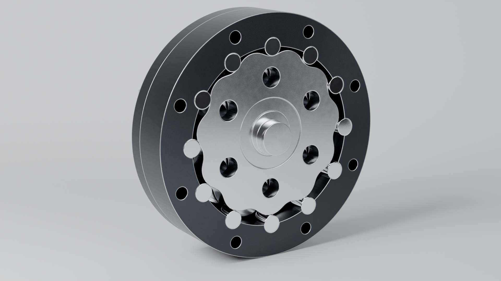
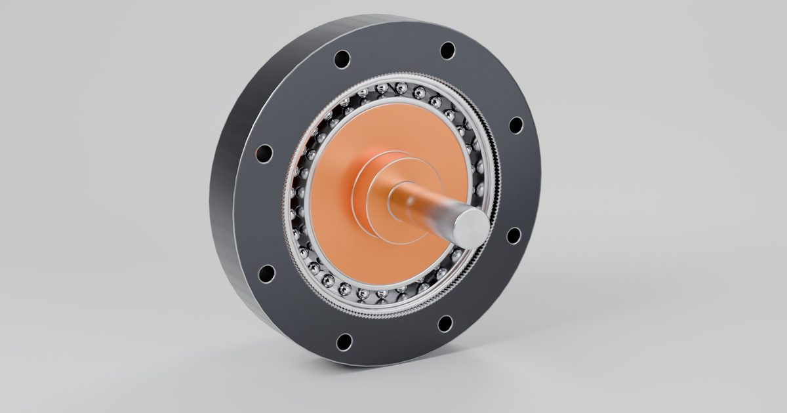
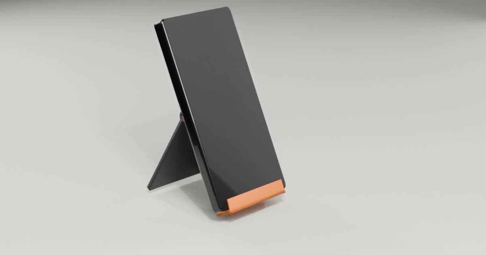
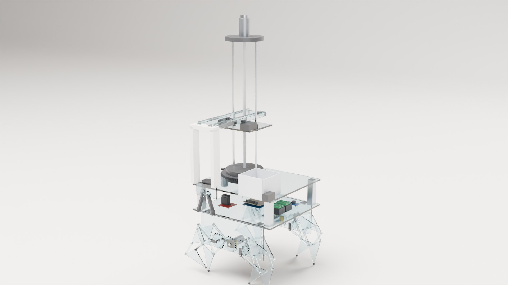
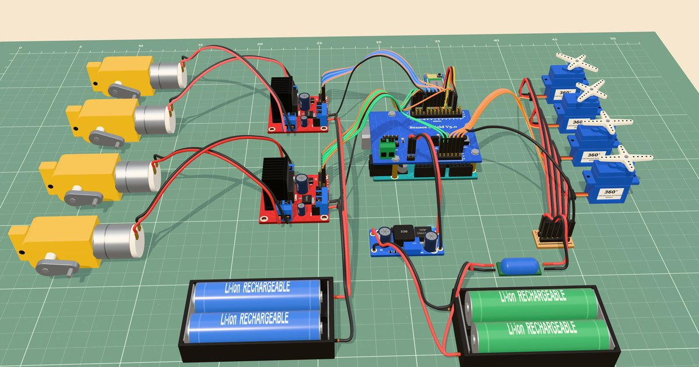
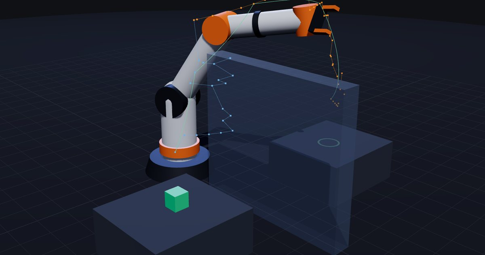
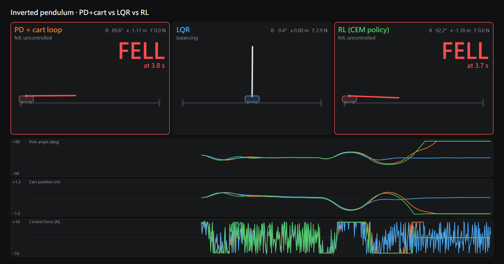
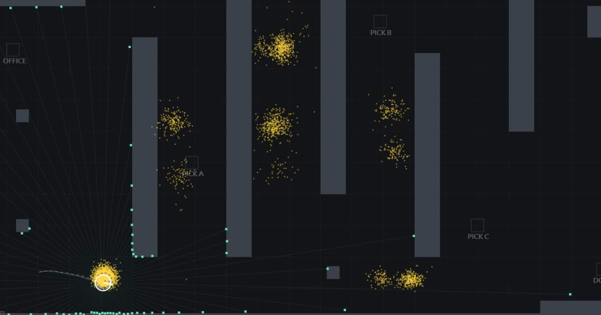

# Engineering demos · 工程作品集

**▶ Open the website (no download, no install): https://0smallcat0.github.io/mechanical-design-demos/**

Runs in any modern browser. The interactive models are built for desktop; on a phone, watch the films on the project pages.

瀏覽器直接開，免安裝；互動模型建議用電腦看。

**Want one for your product? Order on Fiverr:** [mechanical animation](https://www.fiverr.com/lychnis_/create-a-mechanical-animation-showing-how-your-machine-works) · [product renders](https://www.fiverr.com/lychnis_/do-photorealistic-3d-product-rendering-and-exploded-views-from-your-cad) · [CAD model and drawing](https://www.fiverr.com/lychnis_/convert-your-sketch-or-pdf-into-a-3d-cad-model-and-2d-technical-drawing) · [3D viewer for your website](https://www.fiverr.com/lychnis_/build-an-interactive-3d-product-viewer-for-your-website-with-threejs)

---

## CD-11 cycloidal reducer · CD-11 擺線減速機

**▶ [Open the 3D model · 打開 3D 模型](https://0smallcat0.github.io/mechanical-design-demos/cd11-cycloid-reducer/live.html)**  ·  [Project page with video, drawings and CAD files · 專案頁（影片、工程圖、CAD 檔）](https://0smallcat0.github.io/mechanical-design-demos/cd11-cycloid-reducer/)

A gearbox that turns a fast motor (3,000 rpm) into a slow, strong output (272.7 rpm, 11:1). The model moves, and the numbers on both sides (forces, stress, bearing life) are calculated live from the same motion.

11:1 擺線減速機，受力、應力與軸承壽命隨動作即時算出。

How to use:

| Do this | What happens |
| --- | --- |
| Just watch | It starts with an automatic tour |
| Drag with the mouse / scroll | Turn and zoom |
| **EXPLODE** (bottom right) | Pulls the parts apart so you see every piece |
| **CUTAWAY** / **GLASS** | Cuts the housing open / makes it see-through |
| **FORCES** | Shows the force arrows |
| **PAUSE**, **−15° / +15°** (bottom left) | Stop and turn step by step |
| **PLAYBACK** slider | Slow down or speed up |
| **INPUT TORQUE** slider | Load the gearbox harder and watch the forces change |
| **WHY 11:1?** | Explains the gear ratio |

The project page also has a 30-second product film, a 41-second tour of the interactive model, photo-style renders, engineering drawings (PDF) and STEP files that open in any CAD program.

---

## SW-100 strain wave gear · SW-100 諧波減速機

**▶ [Open the 3D model · 打開 3D 模型](https://0smallcat0.github.io/mechanical-design-demos/harmonic-drive/live.html)**  ·  [Project page with video, drawings and CAD files · 專案頁（影片、工程圖、CAD 檔）](https://0smallcat0.github.io/mechanical-design-demos/harmonic-drive/)

The compact gearbox used in robot joints: an oval cam flexes a thin toothed cup (200 teeth) inside a ring with 202, giving 100:1 in one stage. Tooth clearance is checked by code (minimum 0.015 mm, no interference) and the flexspline's fatigue safety factor is 2.03.

100:1 諧波減速機，齒隙與柔輪疲勞由程式驗算。

---

## Print-in-place folding stand · 可列印折疊支架

**▶ [Open the configurator · 打開設計器](https://0smallcat0.github.io/mechanical-design-demos/printable-stand/configurator.html)**  ·  [Project page with video and method · 專案頁（影片與方法）](https://0smallcat0.github.io/mechanical-design-demos/printable-stand/)

A phone or tablet stand that prints in one piece with a working hinge. Set the device size and viewing angle; the model, printability checks (watertight, overhang, hinge clearance) and print-time estimate update live, and **Download STL** gives a file ready for the slicer.

一體列印、鉸鏈直接能轉的支架；網頁改尺寸、檢查可印性、下載 STL。

---

## Eight-legged pick-up robot + EV3 transport robot · 八足取物機器人＋EV3 運輸機器人

**▶ [Open the simulation · 打開模擬](https://0smallcat0.github.io/mechanical-design-demos/walking-pick-robot/live.html)**  ·  [Project page with the product film and tour · 專案頁（產品片、導覽影片）](https://0smallcat0.github.io/mechanical-design-demos/walking-pick-robot/)

University capstone (NCKU Mechanical Engineering, ME3173, six-person team). A walking robot picks up a part and hands it to a line-following EV3 robot. I led the team and owned the pick-up robot's electronics and control: Xbox controller → Python bridge → HC-05 Bluetooth → Arduino UNO, with a 500 ms command timeout so a dropped link stops the robot.

成大機械系專題：八足機器人夾取零件、交給循跡的 EV3 送走；我是組長，負責電控。

| Do this | What happens |
| --- | --- |
| Just watch | It plays the whole pick-and-hand-off sequence |
| Click anywhere, then F / B / L / R | Walk |
| U / D, E / Q, A / Z | Arm up/down, rotate, reach |
| O / C, G / K | Gripper open/close, gate open/close |
| **Cut link** (top right) | Cuts the wireless link; the robot stops after 500 ms |
| View buttons: Overview, Gripper, Electronics… (top) | Jump to a camera view |

The key letters are the same as on the real robot.

---

## Pick-up robot electronics · 取物機器人電控接線

**▶ [Open the app · 打開互動頁](https://0smallcat0.github.io/mechanical-design-demos/robot-electronics/live.html)**  ·  [Project page with video · 專案頁（影片）](https://0smallcat0.github.io/mechanical-design-demos/robot-electronics/)

The pick-up robot's electronics, wired as in its wiring plan, every board generated in code. Hold a command key and the pins, H-bridges, motors and servos respond as the robot's firmware does; switch off the re-send to see the 500 ms safety stop; colour the wires by supply; or wire it wrong on purpose. Checked against the robot's control program (17 pins, 15 constants, 30 commands); the 50 wires pass a supply check (one common ground).

取物機器人照接線計畫的接線與控制邏輯，可下指令、看腳位、試接錯的後果。

---

## Robotics and control simulations · 機器人與控制模擬

### 6-DOF arm: inverse kinematics and motion planning · 六軸手臂逆運動學與路徑規劃

**▶ [Open the app · 打開互動頁](https://0smallcat0.github.io/mechanical-design-demos/robot-arm-planning/live.html)**  ·  [Project page with video and method · 專案頁（影片與方法）](https://0smallcat0.github.io/mechanical-design-demos/robot-arm-planning/)

A factory arm moving a part must reach the exact spot without hitting anything on the way. Drag a target and the arm follows by inverse kinematics; **Plan to target** finds a collision-free path around obstacles (RRT-Connect) and turns it into a smooth trajectory. Tested on 1,000 random poses (worst error 0.01 mm) and 20 planning seeds (all collision-free).

手臂逆運動學與避障路徑規劃，拖曳目標即時解。

---

### Inverted pendulum: PD vs LQR vs reinforcement learning · 倒單擺控制比較

**▶ [Open the app · 打開互動頁](https://0smallcat0.github.io/mechanical-design-demos/inverted-pendulum-control/live.html)**  ·  [Project page with video and method · 專案頁（影片與方法）](https://0smallcat0.github.io/mechanical-design-demos/inverted-pendulum-control/)

Self-balancing robots fall over without the right feedback controller. Three controllers balance the same nonlinear cart-pole side by side. Push a cart, add sensor noise or make the pole heavier and see which one holds. Over 2,000 randomized runs: PD + cart loop survives 80%, LQR 84%, RL 82%; hard cases show where each one fails.

PD、LQR、強化學習三種控制器同場比較，可推車、加雜訊、改擺桿。

---

### Warehouse robot: localization, planning and path following · 倉儲機器人定位與路徑規劃

**▶ [Open the app · 打開互動頁](https://0smallcat0.github.io/mechanical-design-demos/mobile-robot-localization/live.html)**  ·  [Project page with video and method · 專案頁（影片與方法）](https://0smallcat0.github.io/mechanical-design-demos/mobile-robot-localization/)

A warehouse robot has to know where it is before it can fetch anything. A differential-drive robot finds where it is from simulated lidar (particle filter), plans with A* and drives with pure pursuit. In 200 simulated runs it always found itself (median 7.9 s), tracks within about 5 cm, and recovered from 191 of 200 kidnaps. Click to set goals, drop boxes in its way, or kidnap it.

粒子濾波定位、A* 規劃與路徑跟隨，可綁架機器人看它重新定位。

---

## Web 3D example · 網頁互動 3D 範例

Another interactive 3D page, in its own project: [Interactive 3D room with real products](https://0smallcat0.github.io/interactive-3d-room/) (drag, rotate and open furniture in the browser).

---

The interactive model pages are built with the MIT-licensed teardown kit (based on [claude-motion](https://github.com/whaleyxbt/claude-motion)); see [THIRD_PARTY_NOTICES.md](THIRD_PARTY_NOTICES.md).
